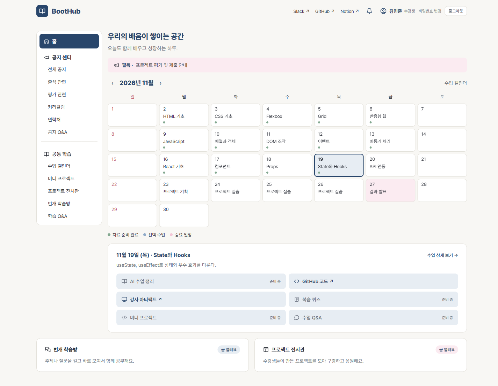
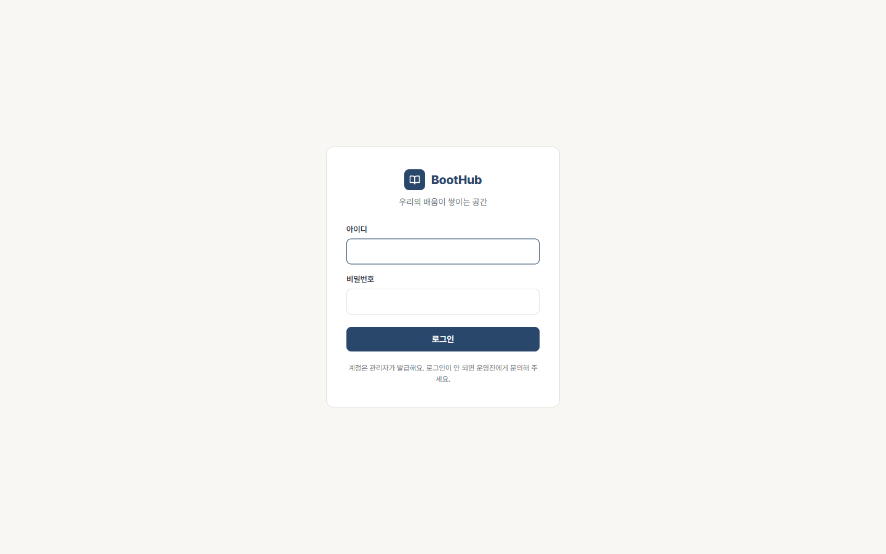
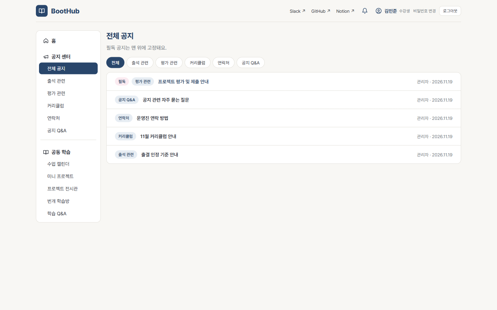
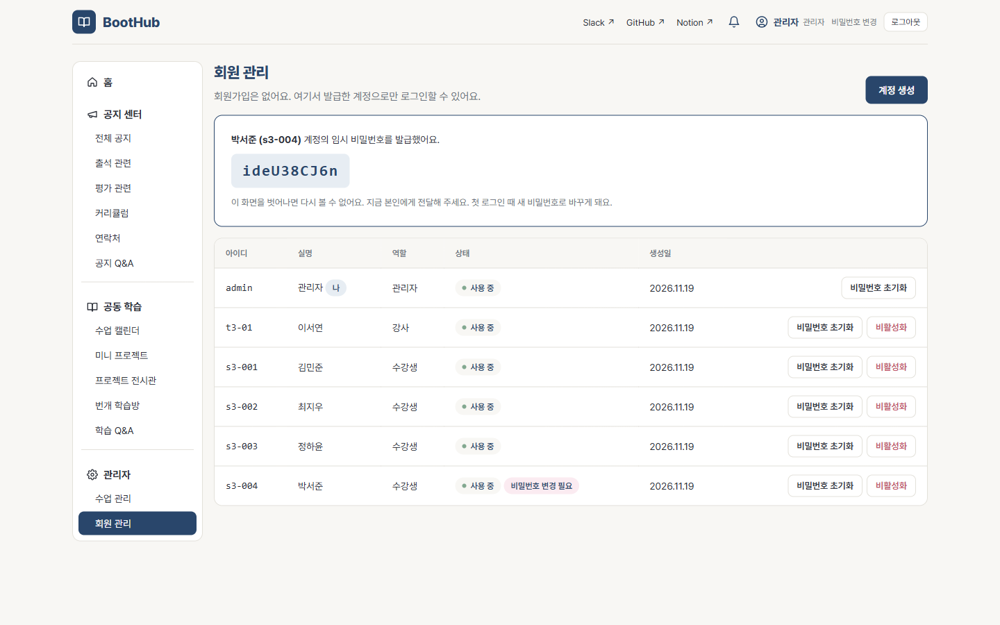
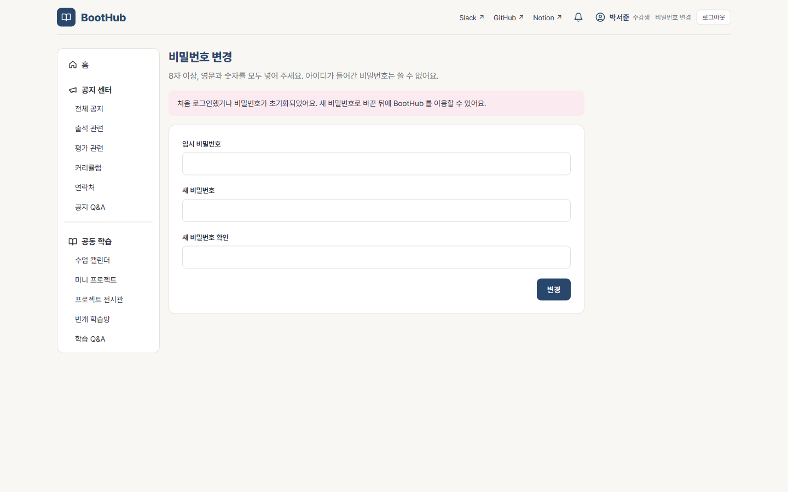
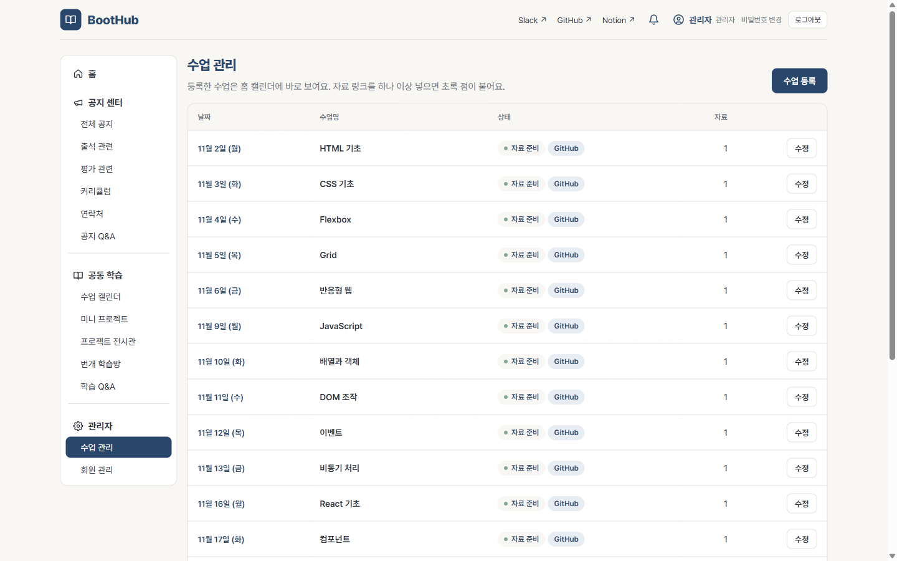
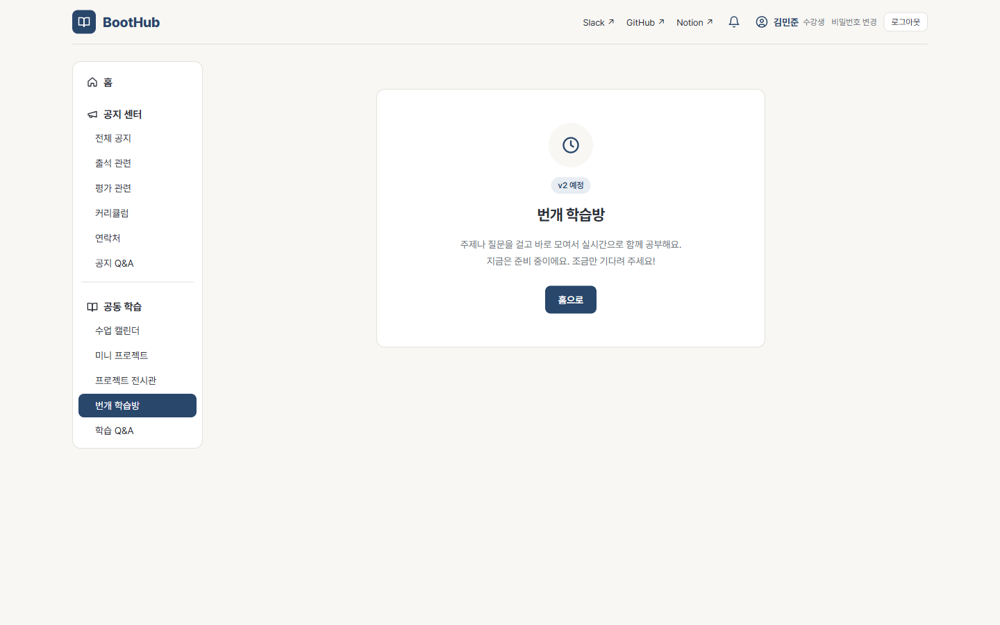

# BootHub

부트캠프 수강생·강사·관리자를 위한 학습 허브입니다.
수업 캘린더, 날짜별 수업 자료(GitHub·강사 아티팩트 링크), 카테고리별 공지, 관리자 계정 발급을 한 곳에서 다룹니다.

> 1일 MVP를 먼저 완성하고, v2 기능은 같은 구조 위에 새 패키지로 쌓아 갑니다.
> 개발 규칙은 [`CLAUDE.md`](CLAUDE.md), v2 AI 모듈 설계는 [`docs/ai-module-spec.md`](docs/ai-module-spec.md)를 참고하세요.



---

## 주요 기능 (MVP)

| 기능 | 내용 |
|---|---|
| 로그인 | 회원가입 없음. 관리자가 발급한 계정으로만 로그인하고, 헤더에 실명이 표시됩니다 |
| 홈 | 필독 공지 배너, 서버 렌더링 월간 캘린더, 선택한 날짜의 수업 상세 패널 |
| 수업 | 날짜별 수업, GitHub 코드 링크, 강사 아티팩트 링크 (링크 등록만, 파일 업로드 없음) |
| 공지 | 출석 / 평가 / 커리큘럼 / 연락처 / 공지 Q&A 카테고리 게시판, 필독 고정 |
| 관리자 | 수업 등록·수정, 자료 링크 추가, 공지 작성, 회원 관리 (계정 생성·비밀번호 초기화·비활성화) |
| 계정 보안 | 시스템이 10자 랜덤 비밀번호를 발급해 한 번만 표시, 첫 로그인 때 비밀번호 변경 강제 |
| 접근 제어 | URL·Service 이중 권한 검사, CSRF, 비활성화·초기화 시 기존 세션 끊기 ([보안](#보안) 참고) |

### 캘린더 표시 규칙

- 초록 점: 자료 준비 완료 (수업 자료(`LessonResource`)가 1개 이상)
- 네이비 테두리 + 연한 블루 배경: 선택한 날짜
- 연분홍 배경: 중요 일정
- 붉은 숫자: 일요일

---

## 스크린샷

| 로그인 | 공지 목록 |
|---|---|
|  |  |

| 회원 관리 (발급 비밀번호 1회 표시) | 첫 로그인 비밀번호 변경 강제 |
|---|---|
|  |  |

| 수업 관리 | v2 준비 중 페이지 |
|---|---|
|  |  |

> 스크린샷은 `local` 프로필의 시드 데이터로 찍었습니다. 회원 관리 화면에서 발급된 비밀번호는 가렸습니다. (실제 화면에서는 10자 비밀번호가 한 번만 보입니다)

---

## 기술 스택

- Java 21, Spring Boot 4 (Spring Security 7, Hibernate 7)
- Spring Web MVC, Thymeleaf, Spring Data JPA, Validation
- Spring Security 폼 로그인 + BCrypt
- H2 (file 모드, `./data/boothub`)
- Lombok
- 프론트: Thymeleaf + 순수 CSS (CSS 변수 디자인 토큰). 외부 CSS/JS 프레임워크 없음, 폰트만 Pretendard CDN

---

## 실행 방법

### 1. 환경변수

| 이름 | 필수 | 설명 |
|---|---|---|
| `BOOTHUB_ADMIN_ID` | 첫 실행 시 | 첫 관리자 아이디 (`^[a-z0-9-]{4,20}$`, 예: `admin`) |
| `BOOTHUB_ADMIN_PASSWORD` | 첫 실행 시 | 첫 관리자 비밀번호 |
| `BOOTHUB_LINKS_SLACK` | 선택 | 헤더 Slack 링크 |
| `BOOTHUB_LINKS_GITHUB` | 선택 | 헤더 GitHub 링크 |
| `BOOTHUB_LINKS_NOTION` | 선택 | 헤더 Notion 링크 |

- 회원 테이블이 비어 있는데 관리자 환경변수가 없으면 앱이 시작되지 않고 이유를 로그로 알려 줍니다.
- 외부 링크는 환경변수 대신 git에 올리지 않는 `src/main/resources/application-local.yaml`에 넣어도 됩니다. (`local` 프로필로 실행할 때만 읽힙니다)
  ```yaml
  boothub:
    links:
      slack: https://...
      github: https://...
      notion: https://...
  ```
- 링크 값이 없으면 헤더에서 비활성으로 보입니다.

### 2. 실행

```bash
# macOS / Linux / Git Bash
export BOOTHUB_ADMIN_ID=admin
export BOOTHUB_ADMIN_PASSWORD='원하는-비밀번호'
./gradlew bootRun --args='--spring.profiles.active=local'
```

```powershell
# Windows PowerShell
$env:BOOTHUB_ADMIN_ID = "admin"
$env:BOOTHUB_ADMIN_PASSWORD = "원하는-비밀번호"
.\gradlew.bat bootRun --args='--spring.profiles.active=local'
```

브라우저에서 <http://localhost:8080> 으로 접속합니다.

### 3. 연습용 계정 (`local` 프로필 전용)

| 아이디 | 실명 | 역할 | 비밀번호 |
|---|---|---|---|
| `t3-01` | 이서연 | 강사 | `1234` |
| `s3-001` | 김민준 | 수강생 | `1234` |
| `s3-002` | 최지우 | 수강생 | `1234` |
| `s3-003` | 정하윤 | 수강생 | `1234` |

고정 비밀번호는 `local` 연습용 계정에만 허용하는 예외입니다. 다른 프로필에서는 첫 관리자만 만들어집니다.
시드 데이터는 테이블이 비어 있을 때만 들어가므로, 처음부터 다시 보고 싶으면 앱을 끄고 `data/` 폴더를 지우세요.

### 4. 테스트

```bash
./gradlew test
```

- `AccessControlTest`: 역할(비로그인·수강생·교수·강사·관리자) × 모든 URL(GET·POST) 권한 표, CSRF, Service 이중 잠금,
  비밀번호 변경 강제, 본인 계정 검사, 세션 끊기, 경로 조작 우회를 확인합니다.
- `H2ConsoleNonLocalTest`: `local`이 아닌 환경에는 H2 콘솔이 등록되지 않는지 확인합니다.
- `ArchitectureTest`: ArchUnit으로 층 방향과 도메인 경계를 확인합니다 ([경계 검증](#경계-검증) 참고).

---

## 계정 규칙

| 역할 | 아이디 형식 | 예 |
|---|---|---|
| 수강생 (STUDENT) | `s{기수}-{번호 3자리}` | `s3-017` |
| 강사 (INSTRUCTOR) | `t{기수}-{번호 2자리}` | `t3-01` |
| 교수 (PROFESSOR) | `p{기수}-{번호 2자리}` | `p3-01` |
| 관리자 (ADMIN) | 고정 이름 | `admin` |

- 아이디는 생성 후 바꿀 수 없습니다.
- 계정 생성·비밀번호 초기화 시 비밀번호는 관리자가 입력하지 않고, 시스템이 `SecureRandom`으로 10자(영문 대소문자+숫자)를 발급해 **화면에 한 번만** 보여 줍니다. DB에는 BCrypt 해시만 저장합니다.
- 발급받은 계정은 첫 로그인 직후 `/account/password`로 이동하며, 변경 전에는 다른 페이지로 갈 수 없습니다.
- 사용자 비밀번호: 8자 이상, 영문과 숫자 포함, 아이디와 같거나 아이디를 포함하면 안 됩니다.
- 비활성화된 계정은 로그인할 수 없습니다. 관리자는 자기 계정을 비활성화할 수 없습니다.
- 계정을 비활성화하거나 비밀번호를 초기화하면, 그 계정으로 이미 로그인해 있던 세션도 끊깁니다.

---

## 보안

URL을 직접 입력해도 권한을 우회할 수 없도록 여러 겹으로 막습니다.

| 항목 | 내용 |
|---|---|
| URL 권한 | 로그인 없이 열리는 곳은 `/login`, `/error`, 정적 리소스(`/css`, `/js`, `/images`, `/favicon.ico`)뿐입니다. `/admin/**`는 GET·POST 모두 ADMIN만, 공지 작성(`/admin/notices/**`)만 ADMIN·INSTRUCTOR가 씁니다. 나머지는 로그인이 필요합니다 |
| 이중 잠금 | `@EnableMethodSecurity`로 관리용 Service 메서드(계정 발급·비밀번호 초기화·비활성화, 수업 등록·수정·자료 추가, 공지 작성)에 `@PreAuthorize`를 붙였습니다. URL 규칙이 빠지더라도 Service에서 한 번 더 막힙니다 |
| CSRF | 로그인을 포함한 모든 POST에 CSRF 토큰이 필요합니다. 예외는 `local` 프로필의 H2 콘솔 경로뿐입니다 |
| 비밀번호 변경 강제 | `mustChangePassword` 계정은 비밀번호를 바꾸기 전까지 `/account/password`, `/logout`, 정적 리소스 외의 모든 요청이 변경 화면으로 이동합니다. 권한 검사보다 먼저 실행되므로 관리자 URL을 직접 입력해도 우회되지 않습니다 |
| 본인 계정 검사 | 비밀번호 변경은 로그인한 본인 계정에만 적용됩니다. 요청에 다른 회원 id를 넣어도 무시하고, Service에서도 본인인지 다시 확인합니다. 관리자는 자기 계정을 비활성화할 수 없습니다 |
| 세션 끊기 | 계정을 비활성화하거나 비밀번호를 초기화하면 그 회원의 기존 로그인 세션(모든 기기)을 끊고 `/login?expired`로 보냅니다. 관리자가 자기 비밀번호를 초기화할 때는 임시 비밀번호를 확인해야 하므로 지금 쓰는 세션만 남깁니다 |
| 경로 조작 | `../`, 인코딩된 `/`, `;` 등이 섞인 요청은 Spring Security 방화벽이 400으로 거부합니다 |
| H2 콘솔 | `local` 프로필에서만 등록되고 ADMIN만 열 수 있습니다. 다른 환경에는 콘솔도, 보안 예외도 없습니다 |
| 403 화면 | 권한이 없거나 CSRF 토큰이 만료되면 공통 레이아웃의 403 안내 화면을 보여 줍니다 |

> 로그인 세션 기록은 서버 메모리에 있습니다 (서버 1대 기준). 서버를 여러 대로 늘리면 Spring Session 같은 공유 저장소로 옮겨야 합니다.

---

## 프로젝트 구조

도메인별 패키지로 나누고, `Controller → Service → Repository` 순서로 호출합니다. 템플릿에는 엔티티 대신 DTO를 넘깁니다.

```
src/main/java/com/wanted/boothub
├── global
│   ├── config       # SecurityConfig(URL 권한·메서드 보안·세션 관리), JpaAuditingConfig, ClockConfig
│   ├── common       # BaseTimeEntity (createdAt, updatedAt)
│   ├── exception    # BusinessException, NotFoundException
│   └── web          # 외부 링크·현재 경로 공통 모델, 준비 중 페이지
├── member           # 회원, 로그인, 로그인 사용자 공통 모델, 시드 계정, 비밀번호 발급·정책·변경 강제, 세션 끊기
├── lesson           # 수업, 수업 자료 링크, 월간 캘린더, 시드 수업
├── notice           # 공지, 카테고리, 필독, 시드 공지
├── admin            # 관리자 화면 컨트롤러 (로직은 각 도메인 Service 호출)
└── home             # 홈 (배너 + 캘린더 + 상세 패널)

src/main/resources
├── application.yaml
├── static/css
│   ├── tokens.css   # 디자인 토큰 (색·폰트·라운드)
│   └── app.css      # 컴포넌트 스타일
└── templates
    ├── layout/      # base, header, sidebar fragment
    ├── home/  lesson/  notice/  admin/  auth/  account/
    ├── common/coming-soon.html
    └── error/       # 403, 404, 500, 4xx, 5xx
```

### 도메인 모델

```
Member ─────────── id, loginId(unique, 변경 불가), password(BCrypt), name, role,
                   active, mustChangePassword
Lesson ──1:N──▶ LessonResource
  id, lessonDate(unique), title,      id, type(ARTIFACT | GITHUB | ETC),
  description, githubUrl, important    title, url, sortOrder
Notice ──N:1──▶ Member(author)
  id, category, title, content, pinned
```

모든 엔티티는 `BaseTimeEntity`를 상속하고, 상태 변경은 Setter 대신 엔티티 메서드(`lesson.update(...)`, `member.resetPassword(...)` 등)로 합니다.

### 경계 검증

도메인을 늘려 가도 바꾸는 비용이 커지지 않도록, 층과 도메인 사이의 경계를 테스트로 지킵니다.

- `global`은 공용 커널입니다. 도메인은 `global`을 써도 되지만, `global`은 도메인 클래스를 모릅니다.
- `admin`·`home`은 화면 조립 계층입니다. 다른 도메인의 Service·DTO만 쓰고 Repository·엔티티는 직접 쓰지 않습니다.

`ArchitectureTest`(ArchUnit)가 `./gradlew test`에서 함께 검사하는 규칙은 다음과 같습니다.

| 규칙 | 내용 |
|---|---|
| 층 방향 | `Controller → Service → Repository` 방향만 허용 |
| 엔티티 | DTO·Controller·Spring 웹 계층에 의존하지 않음 |
| Repository | Service는 다른 도메인의 Repository를 주입받지 않음 (다른 도메인 데이터는 그 도메인 Service로 받음) |
| Policy | `PasswordPolicy` 같은 규칙 클래스는 Spring에 의존하지 않음 |
| 순환 | 도메인 패키지 사이 순환 참조 금지 |
| 공용 커널 | `global`은 도메인 패키지를 import하지 않음 |
| 조립 계층 | `admin`·`home`은 Repository·엔티티를 직접 쓰지 않고, 도메인은 `admin`·`home`을 모름 |

`global`이 member 기능을 써야 할 때는 Spring 타입으로 연결합니다. 예를 들어 `SecurityConfig`는 로그인 성공 처리를 `AuthenticationSuccessHandler` 빈으로 주입받습니다. 비밀번호 변경 강제 필터는 member의 `Customizer<HttpSecurity>` 빈이 모든 보안 체인에 넣습니다.

얽힘 정도는 측정 스크립트로 확인합니다. Python 3.8 이상이면 되고, 표준 라이브러리만 씁니다.

```bash
python scripts/boundary_metrics.py --assembly admin,home               # 측정만
python scripts/boundary_metrics.py --assembly admin,home --mode check  # baseline과 비교
python scripts/boundary_metrics.py --assembly admin,home --mode baseline  # 기준값 다시 저장
```

도메인 간 import, 다른 도메인 Service·Repository 주입, 생성자 파라미터 5개 이상인 클래스, 도메인 순환, git 이력 기준 커밋당 수정 도메인 수를 셉니다. 기준값은 [`docs/boundary-baseline.json`](docs/boundary-baseline.json)에 있습니다. Claude Code에서는 `/check-boundaries com.wanted.boothub check`로 측정부터 ArchUnit 실행, 보고까지 한 번에 할 수 있습니다.

| 항목 | 정리 전 | 현재 |
|---|---|---|
| `global` → 도메인 import | 4 | 0 |
| 다른 도메인 Repository 주입 | 1 | 0 |
| 도메인 간 순환 | 0 (`global` ↔ `member` 순환은 숨어 있었음) | 0 |
| ArchUnit 규칙 위반 | 9건 (2개 규칙) | 0 |

### URL

| 메서드 | URL | 설명 | 권한 |
|---|---|---|---|
| GET | `/login` | 로그인 | 전체 |
| GET/POST | `/account/password` | 본인 비밀번호 변경 | 로그인 |
| GET | `/` | 홈 (`?month=2026-11&date=2026-11-26`) | 로그인 |
| GET | `/lessons/{date}` | 수업 상세 | 로그인 |
| GET | `/notices`, `/notices/{id}` | 공지 목록 (`?category=`)·상세 | 로그인 |
| GET/POST | `/admin/notices/new` | 공지 작성 | ADMIN, INSTRUCTOR |
| GET | `/admin/lessons` | 수업 관리 목록 | ADMIN |
| GET/POST | `/admin/lessons/new`, `/admin/lessons/{id}/edit` | 수업 등록·수정 | ADMIN |
| POST | `/admin/lessons/{id}/resources` | 수업 자료 링크 추가 | ADMIN |
| GET | `/admin/members` | 회원 목록 | ADMIN |
| GET/POST | `/admin/members/new` | 계정 생성 | ADMIN |
| POST | `/admin/members/{id}/reset-password`, `/admin/members/{id}/deactivate` | 비밀번호 초기화·비활성화 | ADMIN |
| GET | `/coming-soon?feature=chat` | v2 준비 중 페이지 | 로그인 |
| — | `/h2-console` | H2 콘솔 (`local` 프로필 전용) | ADMIN |

### 디자인 토큰

| 토큰 | 값 | 용도 |
|---|---|---|
| `--color-ivory` | `#F8F7F4` | 배경 |
| `--color-white` | `#FFFFFF` | 카드 |
| `--color-navy` | `#29466B` | 메인·선택·로고 |
| `--color-blue` | `#91ABC9` | 보조 |
| `--color-green` | `#83A890` | 자료 준비 완료 |
| `--color-pink` | `#F4C6D7` | 강조·중요 일정 |
| `--color-sunday` | `#C2566B` | 캘린더 일요일 |

색은 모두 `tokens.css`의 변수로만 사용하고, 연한 배경은 파생 토큰(`--color-blue-soft`, `--color-pink-soft`)을 씁니다.

---

## v2 로드맵

v2 기능은 지금 사이드바 메뉴와 버튼만 있고, 누르면 "준비 중" 페이지로 연결됩니다.
새 기능은 새 패키지로 추가하고 기존 도메인 코드는 최소한만 건드립니다.

| 기능 | 패키지 | 계획 |
|---|---|---|
| AI 수업 정리 | `material` | 수업 코드·주석을 바탕으로 표/구조 그림 정리. `AiMaterialClient` 인터페이스로 구현체 교체 가능, 결과는 `LessonMaterial`(JSON)로 저장. Mermaid 렌더링만 예외로 mermaid.js 허용 |
| 난이도별 복습 퀴즈 | `material` | `ResourceType`에 `QUIZ` 추가, 응답은 Jackson + Bean Validation으로 검증 |
| 복습용 미니 프로젝트 | `material` | `ResourceType`에 `MINI_PROJECT` 추가 |
| 번개 학습방 | `chat` | ChatRoom(주제, 방장, 공개 여부), ChatMessage. WebSocket(STOMP) 실시간 채팅 |
| 프로젝트 전시관 | `showcase` | 작품명, 설명, GitHub 링크, 작성자, 연관 수업 |
| 학습 Q&A / 수업 Q&A | `qna` | 수업과 선택적으로 연결되는 질문·답변 |
| GitHub 자동 동기화 | `sync` | `GitHubClient` 인터페이스 + 관리자 수동 버튼 → 이후 `@Scheduled` 또는 Webhook |
| 세부 열람 권한 | 미정 | 현재는 로그인 = 열람 허가 |
| 파일 업로드 | — | 현재 아티팩트는 링크 등록만 지원 |

AI 모듈의 상세 설계는 [`docs/ai-module-spec.md`](docs/ai-module-spec.md)에 있습니다.

---

## 개발 단계

| 단계 | 내용 | 상태 |
|---|---|---|
| 1 | 프로젝트 생성, 패키지 구조, 레이아웃, 디자인 토큰, 준비 중 페이지 | 완료 |
| 2 | 회원, 폼 로그인, 시드 계정, 실명 표시, 비밀번호 변경 강제 흐름 | 완료 |
| 3 | 수업·수업 자료, 시드 수업, 홈 캘린더 + 상세 패널 | 완료 |
| 4 | 공지, 카테고리 필터, 필독 배너, 작성 화면 | 완료 |
| 5 | 관리자 수업·자료 링크 관리, 회원 관리 | 완료 |
| 6 | README | 완료 |
| + | 보안 강화: URL·Service 이중 잠금, CSRF, `local` 전용 H2 콘솔, 403 화면, 비활성화·초기화 시 세션 끊기 | 완료 |
| + | 경계 검증: ArchUnit 규칙, 측정 스크립트와 baseline, `global` ↔ `member` 순환·다른 도메인 Repository 주입 정리 | 완료 |
